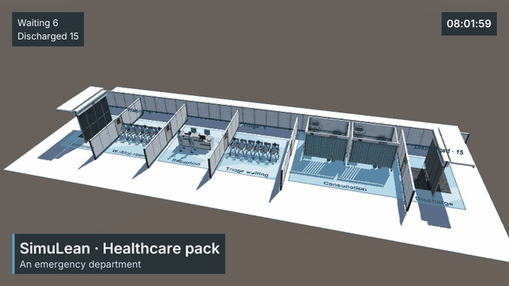
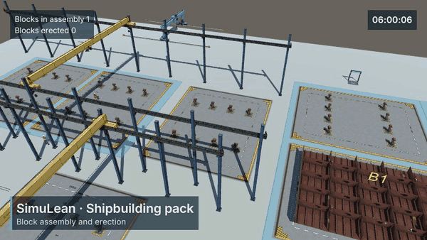

# SimuLean

**A discrete-event simulator built to be modelled by AI agents — and by people.**

|  |  |
|---|---|
| *Healthcare pack — an emergency department* | *Shipbuilding pack — block assembly and erection* |

SimuLean is a discrete-event simulation (DES) engine in C# with a 3D modelling environment in Unity. Its models are
built, checked, run, studied and optimised either in the Unity editor or by an AI agent through **domain commands**
(`simulean_*`) of the editor's MCP server — without writing code.

- **Engine** (`Assets/SimuLean.Net`): items, buffers, stations, assembly, storage, resources with travel and traffic,
  downtime and calendars, lists, signals and reactions, statistics; no Unity dependency, so a model also runs headless.
- **Unity integration** (`Assets/SimuLean.Unity`): a library of elements and sector packs, 3D views and animation,
  connections drawn in the scene, an inspector per element, a results and charts module, a video recorder.
- **Studies and optimisation**: scenarios × replications with common random numbers and confidence intervals, a genetic
  algorithm and random search over any model parameter, distribution fitting, a results store. Studies and optimisations
  run outside the editor in the runner `simulean` ([Tools/Runner](Tools/Runner/README.md), .NET 10): the same results,
  about 10–25× faster on long runs.
- **Agent interface**: 39 commands that cover the whole modelling cycle, with errors and warnings in every answer and a
  check before every run — see [AGENTS.md](AGENTS.md).

> **Paper.** The design of SimuLean as a simulator for AI agents and its evaluation are described in
> J. Pernas-Álvarez and D. Crespo-Pereira, *Agentic discrete-event simulation for manufacturing system design: an open
> 3D simulator, a benchmark and an industrial case*, arXiv:2611.10602 (2026),
> [doi:10.48550/arXiv.2611.10602](https://doi.org/10.48550/arXiv.2611.10602). To cite the software, see
> [CITATION.cff](CITATION.cff) (version 1.0.0: [doi:10.5281/zenodo.23565564](https://doi.org/10.5281/zenodo.23565564)).

## Installation

Download the release's source archive (or clone the repository; git is not needed otherwise) and install what you need:

| What | Needed for | How |
|---|---|---|
| **Unity Hub** and **Unity 6.6** (6000.6.4f1, the version in `ProjectSettings/ProjectVersion.txt`) | everything | Install the Hub, then that editor version from it; *Add project from disk* with this folder. The first import takes several minutes. |
| **Unity CLI** (`unity`) | AI agents: it runs the editor's MCP server | It comes with recent versions of the Unity Hub, or see [Unity CLI](https://docs.unity.com/en-us/unity-cli/replace-mcp-server-unity-cli) in Unity's documentation. Check with `unity --version`; `unity mcp configure <client>` writes the server into a client's configuration (Claude, Cursor, VS Code, Windsurf). |
| An **MCP client** (an AI coding agent) | AI agents | Any client that speaks the Model Context Protocol. With Claude Code, the project's `simulean-modeller` skill loads the agent guide. |
| **.NET 10 SDK** | studies and optimisation outside the editor (the runner, about 10–25× faster on long runs); the headless test suites | From Microsoft's .NET download page. Without it everything works, and studies run inside the editor. |
| Python 3 | the full headless test script (`run-all.ps1`) and the documentation generators | Optional. |
| Blender | only to rebuild the 3D models (`Tools/Blender`) | Optional. |

Developed and tested on Windows.

## Quick start

### With an AI agent

1. Open the project in Unity.
2. Add the editor's MCP server to your agent (`unity mcp configure <client>`, or by hand):
   `{"mcpServers": {"unity-editor-mcp": {"command": "unity", "args": ["mcp", "--project-path", "<this folder>"]}}}`.
   The server offers SimuLean's `simulean_*` commands next to Unity's generic editor tools. The `simulean_*` commands
   alone cover the modelling cycle, so you can give the agent the whole server or only those commands (your client's
   tool allow-list).
3. Point the agent to [AGENTS.md](AGENTS.md) — set-up, rules and the documentation it needs. With Claude Code, the
   project's `simulean-modeller` skill loads it.
4. Ask for a model: *"Build a line with a source (exponential arrivals, mean 5 min), a buffer of 10 and two machines
   (triangular 3–4–6 min); run 10 replications of 8 h and report throughput and waiting time."*

### In the Unity editor

1. Open the project, then **Tools ▸ SimuLean ▸ Open SimuLean** (Ctrl+Shift+L).
2. **Library** tab: click or drag elements into the scene (*Elements*: arrivals and exits, queues and conveyors,
   stations, storage, resources; *Tools*: lists, downtimes, logic, data; sector packs on demand).
3. Connect them with the Connect tool (or each element's *Next Elements*), set their parameters in the inspector.
4. Press **Play** to watch it, or run it headless and study it from the **Experiments** tab; read the **Results** tab.

### From code (headless)

The engine needs no Unity. A model is a `SimulationConfig` (built in code, exported from a scene or read from JSON); each element's
settings are typed (one class per element type) and set by path — a path the type does not have fails, naming the closest one:

```csharp
var model = new SimulationConfig { UseFixedSeed = true, Seed = 1, TimeUnitSeconds = 60, MaxSimulationTime = 480 };  // minutes, 8 h
var src = new ElementConfig("Src", "Source", "Src");
src.Set("mode", "InterArrival");
src.Set("interArrivalDistribution.strategyType", "Exponential");
src.Set("interArrivalDistribution.exponentialRate", 0.5);                     // an arrival every 2 min on average
var buf = new ElementConfig("Buf", "Queue", "Buf");
buf.Set("capacity", 10);
var srv = new ElementConfig("Srv", "MultiServer", "Srv");
srv.Set("capacity", 2);
srv.Set("delayStrategy.strategyType", "Exponential");
srv.Set("delayStrategy.exponentialRate", 0.28);                    // about 3.6 min each, 2 servers
var exit = new ElementConfig("Exit", "Sink", "Exit");
model.Elements.AddRange(new[] { src, buf, srv, exit });
model.Connections.Add(new ConnectionConfig("Src", "Buf", "General"));
model.Connections.Add(new ConnectionConfig("Buf", "Srv", "General"));
model.Connections.Add(new ConnectionConfig("Srv", "Exit", "General"));

var results = new Study(model)
    .Factor("Buf.capacity", 2, 5, 20)                          // three scenarios
    .Metric("out", "Exit.input")
    .Metric("wait", "Buf.stay_avg")
    .WithReplications(10)
    .Run();                                                    // a ResultSet: scenarios × replications
```

A bigger buffer delivers more (about 203, 218 and 233 items in 8 h here) at the price of a longer wait (about 1.7,
3.9 and 9.1 min).

## Example scenes

| Scene | Shows |
|---|---|
| `Assets/Scenes/Validation/MM1.unity` | An M/M/1 queue checked against queueing theory ([validation](docs/guide/validation.md)) |
| `Assets/Scenes/ListsDemo.unity` | Lists: items advertised and pulled by query |
| `Assets/Scenes/ReactionsDemo.unity` | Signals and reactions |
| `Assets/Scenes/ChoiceLogicDemo.unity` | Operating logic: BestScore routing by family, a priority offer order, a flex cell opened by a reaction (admission wake-up), items coloured by family, a choice rule — see it in *Tools ▸ SimuLean ▸ Model Logic* and in its card's *Scripts / Logic* |
| `Assets/Scenes/LibraryExamples/` | The healthcare pack (an emergency department) and the shipbuilding pack (block assembly and erection), each with a Recorder set up for a take; the warehouse that supplies a line; a kitting bench (`Assembly_Kitting`: a Combiner's components travelling into the tote); a gallery of the library's 3D models in a full line (`Factory_3DModels`, a showcase rather than a study model: conveyors, stations, inspection with its reject pusher, palletizer, AS/RS with its stacker crane, robot cell, dashboard); a workshop of shared resources (`Workshop_Resources`: urgent orders take an operator from the normal line, a mechanic repairs the failed machines, an operator breaks down and hands the work over, a results panel); the press changeover (`Setup_Changeover`: a setup matrix and a buffer grouping by setup); an advanced workshop (`Workshop_Advanced`: grouping by setup before a lathe with a setup matrix and its setter, an inspection that reserves room downstream, a mill that secures its machinist before the part, a hall crane then a driver of another team in order, waits with a max wait — Give Up and rush orders rerouted — a reaction on *Wait Timed Out*, repairs and preemption, a results panel) |

## Documentation

| | |
|---|---|
| [AGENTS.md](AGENTS.md), [docs/agents/](docs/agents/workflow.md) | Modelling with an AI agent: workflow, the [command reference](docs/agents/commands.md), [errors](docs/agents/errors.md) |
| [docs/guide/](docs/guide/README.md) | The modelling guide: [what each element does](docs/guide/elements.md), [how a model runs](docs/guide/mechanics.md), [results and data](docs/guide/results-and-data.md), [recipes](docs/guide/recipes.md), [validation](docs/guide/validation.md) |
| [Assets/Docs/](Assets/Docs/) | Topics: expressions, downtime and calendars, signals and reactions, headless runs and experiments, kitting, optional runtime tools |
| [docs/architecture.md](docs/architecture.md) | The software architecture: engine, Unity layer, headless pipeline, optimisation, agent interface |

## Repository layout

| Folder | |
|---|---|
| `Assets/SimuLean.Net/` | The engine (namespace `SimuLean`; its own assembly, no Unity reference) |
| `Assets/SimuLean.Unity/` | The Unity integration: element wrappers, views, editor window, MCP commands, 3D models |
| `Assets/SimuLean.Optimization/`, `Assets/SimuLean.Experimentation/` | The Optimizer and Experimenter components |
| `Assets/Scenes/` | Example scenes |
| `StandaloneTests/` | Headless test suites and the reference models with their baselines (.NET) |
| `Tools/` | The runner `simulean`, model authoring (Blender scripts, floor plans), documentation generators |
| `docs/` | Architecture, the modelling guide, the agent documentation |

## Testing

- `powershell -File StandaloneTests/run-all.ps1` — the engine's test suites and the reference models against their
  baselines, without Unity.
- The Unity EditMode tests: *Window ▸ General ▸ Test Runner*, or `simulean_test` through the MCP.

## License and authors

SimuLean is released under the [GNU GPLv3](LICENSE). Third-party libraries (ExcelDataReader and `System.*` packages,
MIT) are in `Assets/Plugins/SimuLeanDependencies`. The 3D models are generated by the scripts in `Tools/Blender`.

Authors: [Javier Pernas-Álvarez](https://pdi.udc.es/en/File/Pdi/HF9NK) and
[Diego Crespo-Pereira](https://pdi.udc.es/en/File/Pdi/6W6MH), Universidade da Coruña. Contact:
<javier.pernas2@udc.es>.
