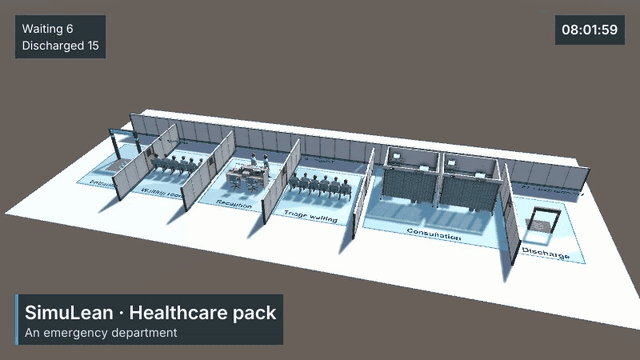
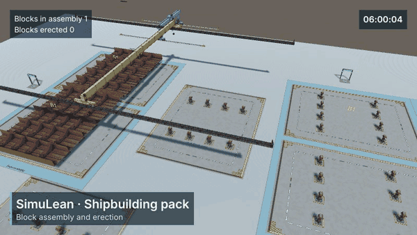

# SimuLean

**A discrete-event simulator built to be modelled by AI agents — and by people.**

|  |  |
|---|---|
| *Healthcare pack — an emergency department* | *Shipbuilding pack — block assembly and erection* |

SimuLean is a discrete-event simulation (DES) engine in C# with a 3D modelling environment in Unity. Its models are
built, checked, run, studied and optimised either in the Unity editor or by an AI agent through **domain commands**
(`simulean_*`) of the editor's MCP server — without writing code.

- **Engine** (`Assets/SimuLean.Net`): items, buffers, stations, assembly, storage, resources with travel and traffic,
  downtime and calendars, lists, signals and reactions, statistics; no Unity dependency, so a model also runs headless.
- **Unity integration** (`Assets/SimuLean.Unity`): a library of elements and sector packs, 3D views and animation,
  connections drawn in the scene, an inspector per element, a results and charts module, a video recorder.
- **Studies and optimisation**: scenarios × replications with common random numbers and confidence intervals, a genetic
  algorithm and random search over any model parameter, distribution fitting, a results store.
- **Agent interface**: 31 commands that cover the whole modelling cycle, with errors and warnings in every answer and a
  check before every run — see [AGENTS.md](AGENTS.md).

> **Paper.** The design of SimuLean as a simulator for AI agents and its evaluation are described in a paper — the arXiv
> link will be added here on publication.

## Quick start

**Requirements:** Unity **6.6** (6000.6.4f1). For agents: Unity's command-line tool (`unity`, its MCP server). For the
headless test suites: the .NET 8 SDK. Developed and tested on Windows.

### With an AI agent

1. Open the project in Unity.
2. Add the editor's MCP server to your agent:
   `{"mcpServers": {"unity-editor-mcp": {"command": "unity", "args": ["mcp", "--project-path", "<this folder>"]}}}`.
3. Point the agent to [AGENTS.md](AGENTS.md) — set-up, rules and the documentation it needs. With Claude Code, the
   project's `simulean-modeller` skill loads it.
4. Ask for a model: *"Build a line with a source (exponential arrivals, mean 5 min), a buffer of 10 and two machines
   (triangular 3–4–6 min); run 10 replications of 8 h and report throughput and waiting time."*

### In the Unity editor

1. Open the project, then **Tools ▸ SimuLean ▸ Open SimuLean** (Ctrl+Shift+L).
2. **Library** tab: click or drag elements into the scene (*Elements*: arrivals and exits, queues and conveyors,
   stations, storage, resources; *Tools*: lists, downtimes, logic, data; sector packs on demand).
3. Connect them with the Connect tool (or each element's *Next Elements*), set their parameters in the inspector.
4. Press **Play** to watch it, or run it headless and study it from the **Experiments** tab; read the **Results** tab.

### From code (headless)

The engine needs no Unity. A model is a `SimulationConfig` (built in code, exported from a scene or read from JSON):

```csharp
var model = new SimulationConfig { UseFixedSeed = true, Seed = 1, TimeUnitSeconds = 60, MaxSimulationTime = 480 };  // minutes, 8 h
var src = new ElementConfig("Src", "UnitySource", "Src");
src.Parameters["sourceMode"] = "InterArrival";
src.Parameters["interArrivalStrategyType"] = "Exponential";
src.Parameters["exponentialRate"] = 0.5;                       // an arrival every 2 min on average
var buf = new ElementConfig("Buf", "UnityQueue", "Buf");
buf.Parameters["capacity"] = 10;
var srv = new ElementConfig("Srv", "UnityMultiServer", "Srv");
srv.Parameters["capacity"] = 2;
srv.Parameters["delayStrategyType"] = "Exponential";
srv.Parameters["exponentialRate"] = 0.28;                      // about 3.6 min each, 2 servers
var exit = new ElementConfig("Exit", "UnitySink", "Exit");
model.Elements.AddRange(new[] { src, buf, srv, exit });
model.Connections.Add(new ConnectionConfig("Src", "Buf", "General"));
model.Connections.Add(new ConnectionConfig("Buf", "Srv", "General"));
model.Connections.Add(new ConnectionConfig("Srv", "Exit", "General"));

var results = new Study(model)
    .Factor("Buf.capacity", 2, 5, 20)                          // three scenarios
    .Metric("out", "Exit.input")
    .Metric("wait", "Buf.stay_avg")
    .WithReplications(10)
    .Run();                                                    // a ResultSet: scenarios × replications
```

A bigger buffer delivers more (about 203, 218 and 233 items in 8 h here) at the price of a longer wait (about 1.7,
3.9 and 9.1 min).

## Example scenes

| Scene | Shows |
|---|---|
| `Assets/Scenes/Validation/MM1.unity` | An M/M/1 queue checked against queueing theory ([validation](docs/guide/validation.md)) |
| `Assets/Scenes/AssemblyLine.unity` | Chassis and cover plates assembled by a Combiner, then finishing on two servers; two simple lines |
| `Assets/Scenes/CombinerScene.unity` | A Combiner (main item + components) with an operator team |
| `Assets/Scenes/ListsDemo.unity` | Lists: items advertised and pulled by query |
| `Assets/Scenes/ReactionsDemo.unity` | Signals and reactions |
| `Assets/Scenes/ResourceExamples/` | Operators (abstract, walking, on a grid), AGVs, a robot cell, a gantry stacker, physics calibration, block assembly with cranes |
| `Assets/Scenes/LibraryExamples/` | The healthcare pack (an emergency department) and the shipbuilding pack (block assembly and erection), each with a Recorder set up for a take |

## Documentation

| | |
|---|---|
| [AGENTS.md](AGENTS.md), [docs/agents/](docs/agents/workflow.md) | Modelling with an AI agent: workflow, the [command reference](docs/agents/commands.md), [errors](docs/agents/errors.md) |
| [docs/guide/](docs/guide/README.md) | The modelling guide: [what each element does](docs/guide/elements.md), [how a model runs](docs/guide/mechanics.md), [results and data](docs/guide/results-and-data.md), [recipes](docs/guide/recipes.md), [validation](docs/guide/validation.md) |
| [Assets/Docs/](Assets/Docs/) | Topics: expressions, downtime and calendars, signals and reactions, headless runs and experiments, kitting, optional runtime tools |
| [docs/architecture.md](docs/architecture.md) | The software architecture: engine, Unity layer, headless pipeline, optimisation, agent interface |

## Repository layout

| Folder | |
|---|---|
| `Assets/SimuLean.Net/` | The engine (namespace `SimuLean`; its own assembly, no Unity reference) |
| `Assets/SimuLean.Unity/` | The Unity integration: element wrappers, views, editor window, MCP commands, 3D models |
| `Assets/SimuLean.Optimization/`, `Assets/SimuLean.Experimentation/` | The Optimizer and Experimenter components |
| `Assets/Scenes/` | Example scenes |
| `StandaloneTests/` | Headless test suites and the reference models with their baselines (.NET) |
| `Tools/` | Model authoring (Blender scripts, floor plans), documentation generators |
| `docs/` | Architecture, the modelling guide, the agent documentation |

## Testing

- `powershell -File StandaloneTests/run-all.ps1` — the engine's test suites and the reference models against their
  baselines, without Unity.
- The Unity EditMode tests: *Window ▸ General ▸ Test Runner*, or `simulean_test` through the MCP.

## License and authors

SimuLean is released under the [GNU GPLv3](LICENSE). Third-party libraries (ExcelDataReader and `System.*` packages,
MIT) are in `Assets/Plugins/SimuLeanDependencies`. The 3D models are generated by the scripts in `Tools/Blender`.

Authors: [Javier Pernas-Álvarez](https://pdi.udc.es/en/File/Pdi/HF9NK) and
[Diego Crespo-Pereira](https://pdi.udc.es/en/File/Pdi/6W6MH), Universidade da Coruña. Contact:
<javier.pernas2@udc.es>.
